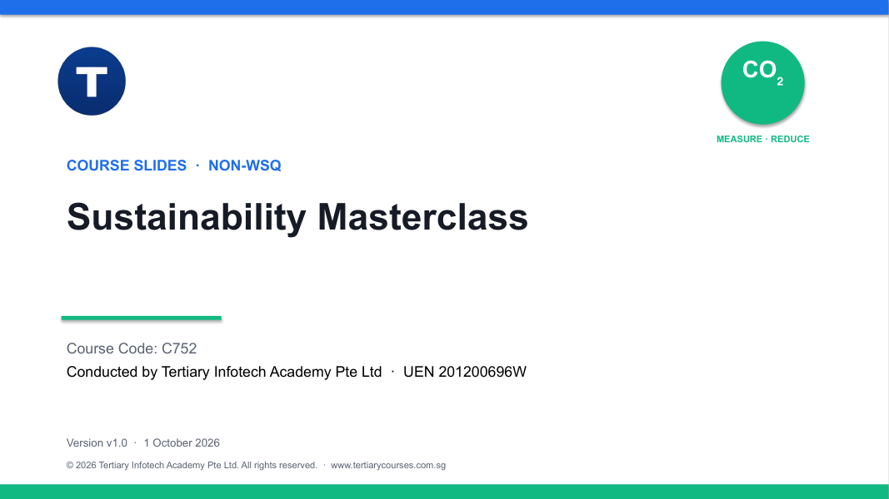

# Sustainability Masterclass

A practical two-day masterclass on carbon footprint management: find your organisation's emission hotspots, prioritise the reductions worth backing, and build a reduction plan someone can actually run.



| Course detail | Information |
|---|---|
| Course code | `C752` |
| Programme | Non-WSQ |
| Duration | 2 days · 15 instructional hours (9:30am – 5:30pm) |
| Registration | [View course details and register](https://www.tertiarycourses.com.sg/sustainability-masterclass.html) |

## About the course

Carbon accounting is not the finish line — it is the evidence system that helps people choose and deliver better reductions. This masterclass takes you from a defensible carbon inventory to a board-ready reduction plan. You work with recognised standards (GHG Protocol, ISO 14001, ISO 14064), Singapore's carbon-tax and measurement-and-reporting context, and nine real-use-case activities built around Singapore businesses.

It suits managers, sustainability officers, operations and finance staff, and anyone who needs to turn a carbon footprint into decisions.

## Learning outcomes

By the end of the course you will be able to:

1. Analyse carbon emission hotspots using recognised standards, boundaries and reliable activity data.
2. Prioritise carbon-footprint reduction initiatives using projections, feasibility, cost-benefit and decision tools.
3. Develop an implementable carbon-footprint reduction plan with governance, targets, monitoring and continual improvement.

## Topics covered

**Topic 1 — Analyse Carbon Emission Hotspots**
Standards and inventory framing, organisational and operational boundaries, the seven greenhouse gases, activity × factor calculations, data quality, Scopes 1–3, hotspot analysis, Singapore electricity factors, and the economics of reduction (payback, NPV, marginal abatement cost, internal carbon pricing).

**Topic 2 — Prioritise Reduction Initiatives**
Baselines and business-as-usual projections, absolute vs intensity targets, scenarios and uncertainty, the reduction hierarchy, energy, operations, value-chain and circularity levers, Industry 4.0 and ERP footprint platforms, feasibility screens and pilots, MACC and multi-criteria portfolio decisions.

**Topic 3 — Develop the Reduction Plan**
Environmental management systems and PDCA, governance, data controls, management review and audit, plan architecture, target design, roadmaps and KPI trees, responsible claims, action plans and RACI, stage gates, measurement and verification, and Singapore carbon-tax and MR readiness.

## Activities

Each activity folder holds a scenario, questions, a procedure and a CSV dataset.

1. [Map a Multi-Site Corporate Inventory](activities/activity-01-boundary-and-scope-mapping/)
2. [Use the SG Carbon Calculator as an Engagement Tool](activities/activity-02-personal-screening-with-sg-carbon-calculator/)
3. [Find Hotspots in a Farm-to-Table Value Chain](activities/activity-03-farm-to-table-hotspot-analysis/)
4. [Model a Singapore Fleet Transition](activities/activity-04-logistics-emissions-scenario-model/)
5. [Screen a Smart-Factory Carbon Initiative](activities/activity-05-smart-factory-feasibility-screen/)
6. [Prioritise a Reduction Portfolio](activities/activity-06-macc-and-mcda-portfolio/)
7. [Prepare a Singapore MR and Carbon-Tax Readiness Plan](activities/activity-07-singapore-carbon-tax-and-mr-readiness/)
8. [Design an Employee ActNow Programme](activities/activity-08-employee-actnow-programme/)
9. [Build the Board-Ready Carbon Reduction Plan](activities/activity-09-capstone-reduction-plan/)

## Courseware package (v1.0)

| Item | Files |
|---|---|
| Slide deck (124 slides) | [PPTX](<courseware/Sustainability Masterclass (C752)-v1.0.pptx>) · [PDF](<courseware/Sustainability Masterclass (C752)-v1.0.pdf>) |
| Learner Guide | [DOCX](<courseware/LG-Sustainability Masterclass (C752).docx>) · [PDF](<courseware/LG-Sustainability Masterclass (C752).pdf>) · [Markdown](<LG-Sustainability Masterclass (C752).md>) |
| Lesson Plan | [DOCX](<courseware/LP-Sustainability Masterclass (C752).docx>) · [PDF](<courseware/LP-Sustainability Masterclass (C752).pdf>) |
| Activities | [activities/](activities/) — nine folders with scenario, questions and data |

The slides are deliberately visual; procedures, calculations and evidence expectations live in the Learner Guide and the activity folders.

Regulatory rates, thresholds, emission factors and reporting requirements change. Verify current primary sources before external reporting, filing or committing capital.

## Repository structure

```text
courseware/        Slide deck, Learner Guide and Lesson Plan (editable + PDF)
activities/        One self-contained folder per activity
tools/             Scripts that rebuild this courseware from its source course
LG-*.md            Markdown mirror of the Learner Guide
```

## Distribution

This repository publishes the learner-facing courseware. Trainer reference material and source files are kept out of the public repository.

---

Provided by [Tertiary Infotech Academy Pte Ltd](https://www.tertiarycourses.com.sg/) · UEN 201200696W
